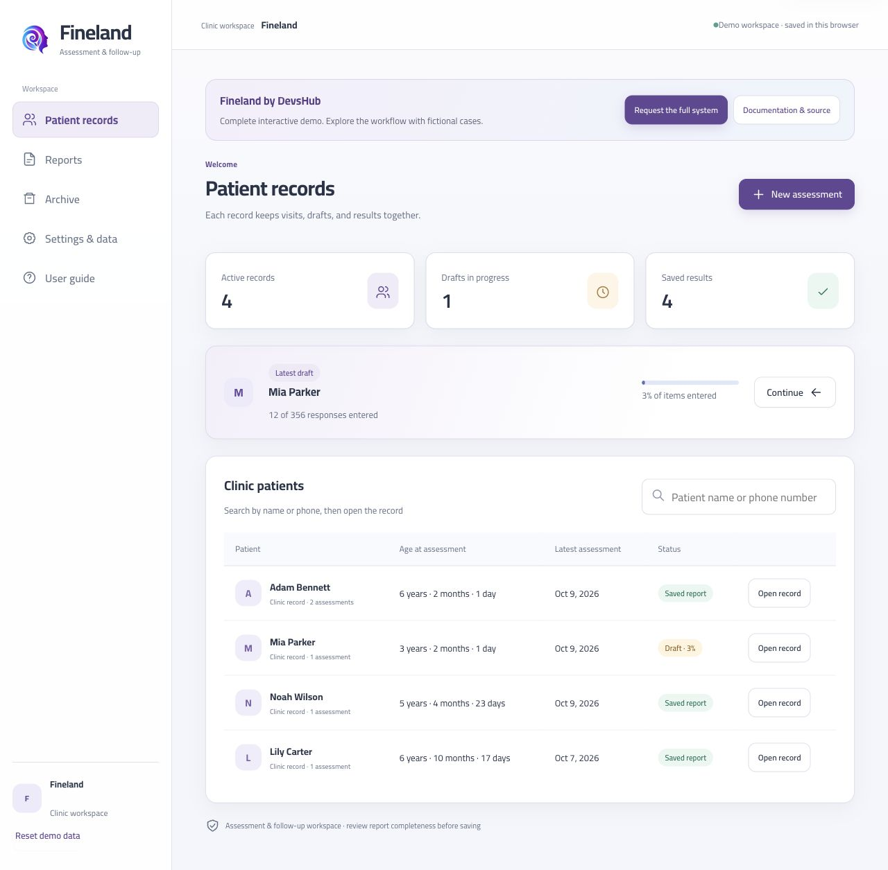
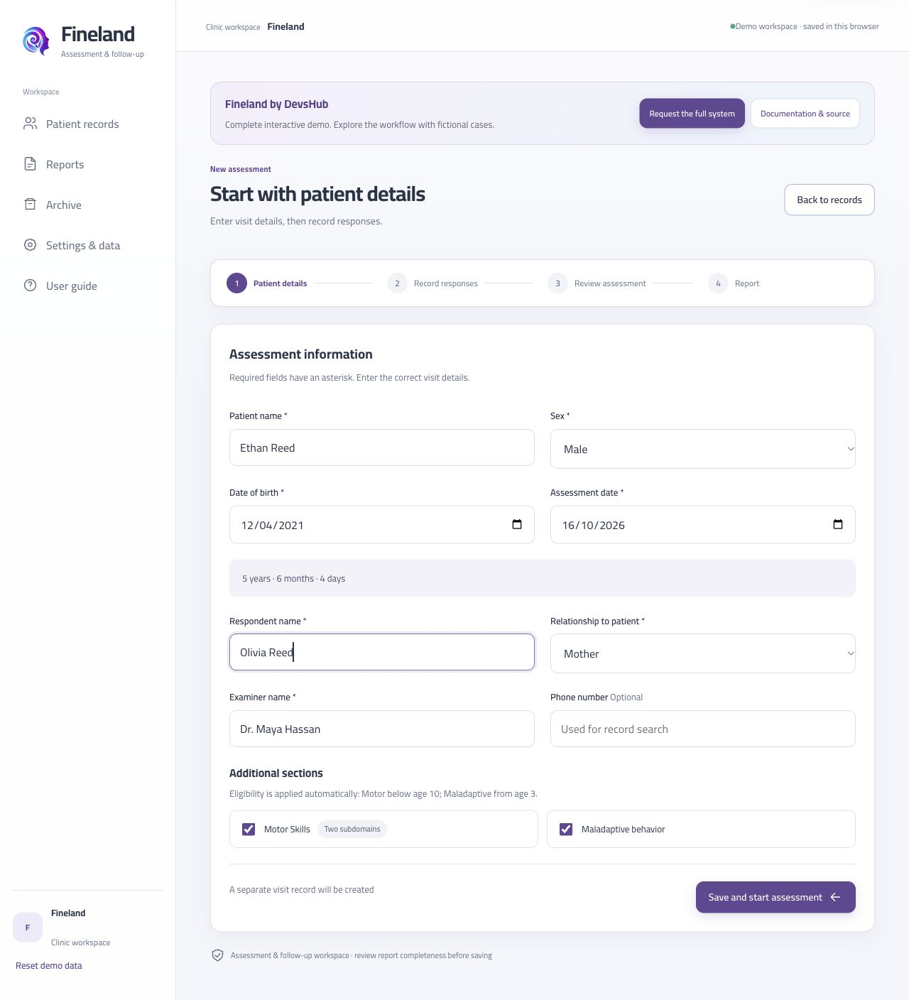
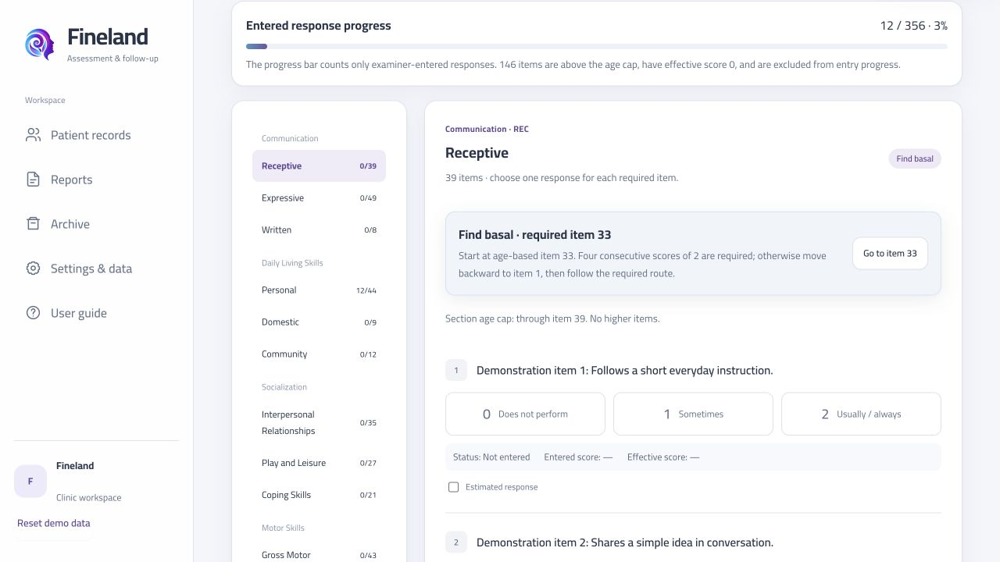
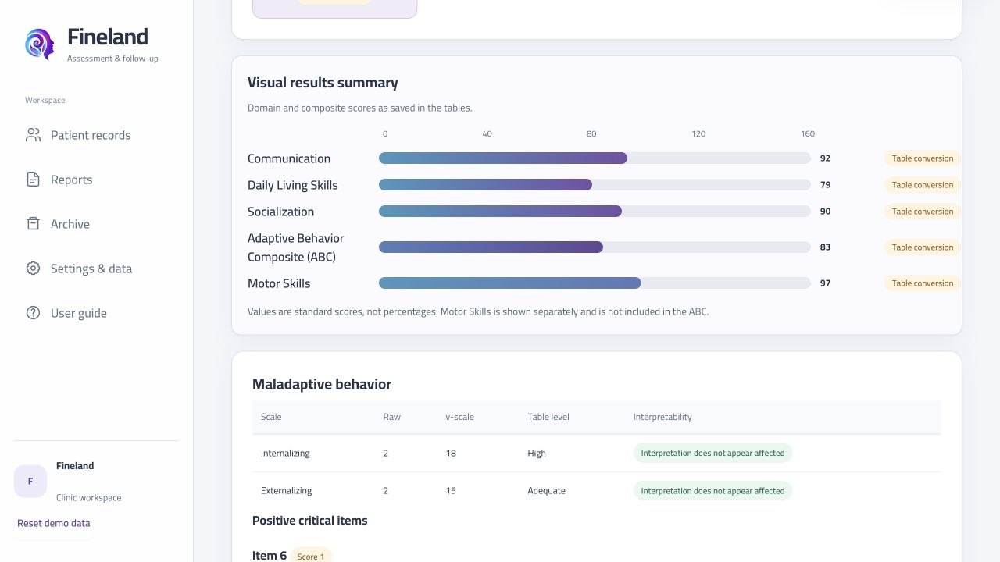
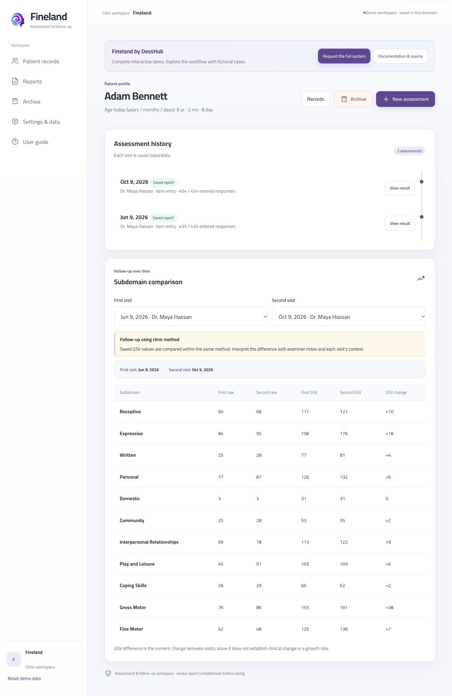
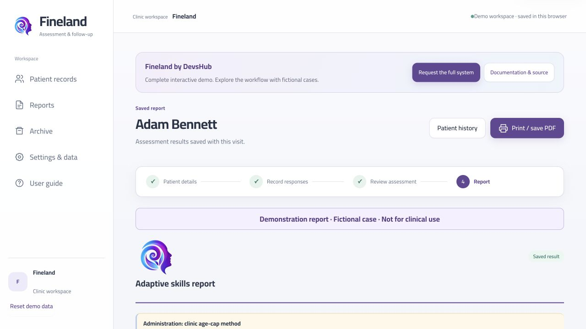

# Fineland by DevsHub

**From interview to insight, in one clear assessment workspace.** Fineland brings case intake, adaptive-behavior assessment, scoring, follow-up comparison, and printable reports into one guided experience.

[**Explore the live preview →**](https://fineland-demo.vercel.app/) · [**Contact DevsHub for the full system →**](https://github.com/HostX0)

> **Frontend preview only.** This public demo uses fictional cases and demonstration item wording. Changes stay in your browser; the preview has no connection to the live clinic system or its records. The complete clinic system is available by contacting the [repository owner](https://github.com/HostX0). Use fictional information only; demo results are not for clinical decisions.

## See the experience

Actual screens from the interactive preview. All people and assessment records shown below are fictional.

### Patient workspace

Find a case quickly, resume an unfinished interview, and keep each person's visits and reports together.

### Guided assessment intake

Record the patient, respondent, and visit details. Chronological age is calculated from the dates, and eligible sections are selected for the assessment.

### Focused interview entry

Move between subdomains, enter 0/1/2 responses, flag estimated answers, and follow visible routing and basal guidance. Progress makes unfinished work easy to identify.

### Results at a glance

Review domain and composite scores in a visual summary, with maladaptive behavior shown separately. Motor Skills is displayed separately and is excluded from the Adaptive Behavior Composite.

### Follow-up over time

Open the patient's assessment history and compare two visits side by side, including raw scores and Growth Scale Values (GSV).

### Reports ready to review and print

Keep the visit details, scores, and analysis in a readable report. Print it or save it as a PDF through the browser.

## The problem Fineland addresses

An adaptive-behavior assessment can involve paper forms, manual calculations, scoring references, and a separate report document. Repeating those steps for later visits creates extra transcription work and makes comparisons harder to organize.

Fineland connects the workflow so the clinic team can focus on reviewing the assessment and discussing the next step with the family.

## What you can explore

| Area | Features in the preview |
| --- | --- |
| **Case management** | Searchable records, separate visits, saved drafts, assessment history, and archive. |
| **Intake** | Patient and respondent details, interview date, chronological age, examiner details, and optional phone number. |
| **Response entry** | Item responses or raw-score entry, estimated-response flags, section navigation, and progress tracking. |
| **Assessment routing** | A reference interview route and a separate clinic age-cap method, with basal and ceiling handling. |
| **Scoring and analysis** | Subdomain v-scales, domain scores, Adaptive Behavior Composite, age equivalents, GSV, confidence intervals, strengths, weaknesses, and pairwise comparisons. |
| **Additional sections** | Motor Skills when age-eligible, maladaptive behavior, and positive critical-item notes in separate areas. |
| **Follow-up** | Compare assessments from two visits while keeping each saved result with its own visit. |
| **Reporting** | A structured assessment report, visual results, clinic identity and logo settings, and browser print / save as PDF. |
| **Try and reset** | Example responses and fictional saved cases help you explore; reset restores the sample workspace. |

GSV change is a numeric difference between visits. It is not a growth rate and does not, by itself, establish clinical change.

## Try the complete journey

1. Open the [live preview](https://fineland-demo.vercel.app/).
2. Explore a fictional patient record and compare its saved visits.
3. Continue the sample draft or start a new assessment with invented details.
4. Enter responses, or use **Fill example responses** to explore the review flow.
5. Review the results and the printable report.
6. Use **Reset demo data** to restore the original examples whenever needed.

Demo information is saved only in the current browser profile. It does not sync between devices or provide a clinical account. Clearing the demo's site data removes your local examples.

## Assessment context

The demonstration presents a workflow based on the **Vineland Adaptive Behavior Scales, Third Edition (Vineland-3), Comprehensive Interview Form**. The reference interview route and the separate clinic age-cap method are distinguished throughout the experience; their results are not interchangeable.

Vineland-3 is a Pearson instrument. Fineland is an independent demonstration and is not endorsed by Pearson. Demonstration scoring does not establish clinical validation or authorization to administer the instrument. The preview uses demonstration item wording rather than licensed interview questions.

## Request the full clinic system

This repository shares the **interactive frontend preview**. To obtain the complete system or discuss a tailored clinic deployment, contact **DevsHub / Abdulazeez A. Noaman** through the [owner's GitHub profile](https://github.com/HostX0).

[**Open Fineland on Vercel**](https://fineland-demo.vercel.app/)
